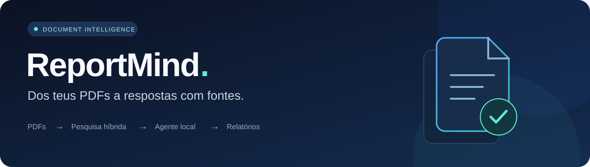
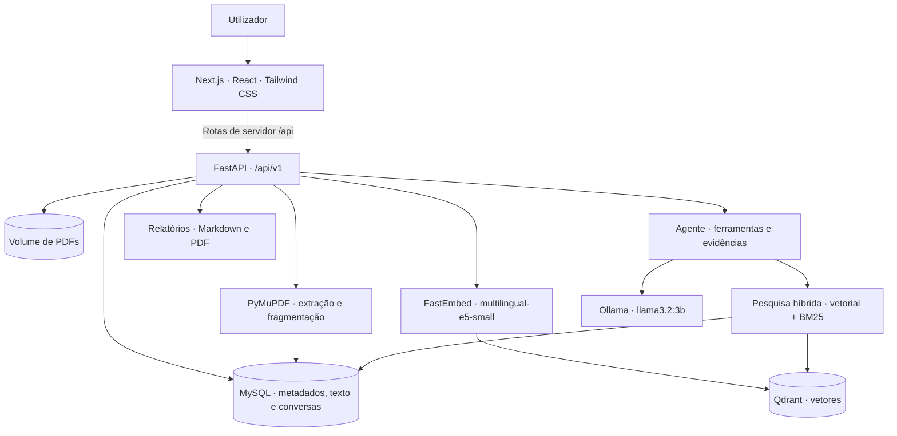

<p align="center">
  
</p>

<p align="center">
  <strong>Organiza documentos. Explora evidências. Gera relatórios com IA local.</strong>
</p>

<p align="center">
  
  
  
  
  
  
</p>

<p align="center">
  <a href="#o-que-é-o-reportmind">Sobre</a> ·
  <a href="#funcionalidades">Funcionalidades</a> ·
  <a href="#início-rápido">Instalação</a> ·
  <a href="#arquitetura">Arquitetura</a> ·
  <a href="#api">API</a> ·
  <a href="#segurança-e-publicação-no-github">Segurança</a>
</p>

---

## O que é o ReportMind?

O **ReportMind** é uma aplicação para transformar PDFs numa base de conhecimento consultável. Permite carregar documentos, extrair e indexar o texto, fazer perguntas sobre vários ficheiros e gerar relatórios com referências às fontes utilizadas.

A pesquisa combina **embeddings multilingues e BM25**. Um agente com acesso a ferramentas decide quando pesquisar, consultar metadados ou ler fragmentos completos antes de responder. A interface apresenta as ações executadas e as evidências consultadas.

A inferência utiliza **Ollama**, e os embeddings são gerados no backend. O fluxo padrão não exige chaves de APIs de IA pagas nem envia o conteúdo dos PDFs para um fornecedor de LLM externo. A instalação inicial precisa de internet para descarregar dependências, imagens e modelos.

> **Estado do projeto:** aplicação para desenvolvimento e demonstração local. Ainda não tem autenticação, autorização por utilizador ou isolamento entre contas. Publicar o código no GitHub não significa que a aplicação esteja preparada para exposição pública na internet.

## Funcionalidades

- **Dashboard:** estado dos serviços, estatísticas da biblioteca e acesso às demonstrações.
- **Biblioteca de PDFs:** upload por seleção ou drag and drop, listagem, detalhes e eliminação. Validação da extensão, MIME, assinatura e tamanho do ficheiro.
- **Extração de texto:** processamento manual com PyMuPDF, texto por página, limpeza, identificação de secções e divisão em fragmentos com sobreposição.
- **Indexação local:** embeddings com `intfloat/multilingual-e5-small`, vetores de 384 dimensões e persistência no Qdrant.
- **Pesquisa híbrida:** pesquisa semântica e BM25 combinadas por Reciprocal Rank Fusion, limitada aos documentos selecionados.
- **Agente documental:** ferramentas para pesquisar, consultar documentos e ler fragmentos, com limites de iterações e chamadas.
- **Conversas persistentes:** histórico guardado em MySQL, retoma e eliminação de conversas.
- **Revisão de riscos:** modo dedicado a procurar riscos e contradições nos documentos selecionados, sujeito à cobertura da pesquisa e aos limites do modelo.
- **Estúdio de relatórios:** geração a partir de até dez PDFs indexados, pré-visualização, fontes e exportação em **Markdown e PDF**.
- **Demonstração incluída:** criação e indexação automática de dois PDFs sintéticos, Project Alpha e Project Beta.

## Início rápido

### 1. Pré-requisitos

- Git e Docker com Docker Compose.
- Internet para a primeira instalação e descarga dos modelos.
- Memória e espaço em disco disponíveis para MySQL, Qdrant, embeddings e Ollama. A configuração padrão executa a inferência no contentor sem configuração de GPU; a velocidade depende do equipamento e dos recursos atribuídos ao Docker.

Python e Node.js no computador anfitrião só são necessários para desenvolvimento fora dos contentores.

### 2. Clonar e configurar

```sh
git clone https://github.com/gabriel-duarte25/ReportMind.git
cd ReportMind
cp .env.example .env
```

Edita o `.env` e substitui **`MYSQL_PASSWORD` e `MYSQL_ROOT_PASSWORD`** por palavras-passe únicas e diferentes. Podes gerar cada uma com:

```sh
openssl rand -hex 24
```

O `.env.example` contém valores de exemplo públicos; o `.env` contém a configuração privada e fica excluído do Git.

### 3. Iniciar a aplicação

```sh
docker compose up --build -d
docker compose ps
```

Na primeira execução, o Docker prepara os serviços, o Alembic aplica as migrações, o serviço `ollama-model` descarrega o modelo e o `demo-seed` prepara os dois PDFs de exemplo. A primeira indexação também descarrega o modelo de embeddings. Estas operações podem demorar vários minutos.

```sh
docker compose logs -f ollama-model demo-seed
```

O frontend aguarda a conclusão do `demo-seed`. A conclusão desse serviço não garante que o download do modelo Ollama já tenha terminado.

### 4. Aceder

As portas abaixo são as predefinidas no `.env.example`:

- **Aplicação:** [localhost:3000](http://localhost:3000)
- **Documentação interativa da API:** [localhost:8000/docs](http://localhost:8000/docs)
- **Saúde da API:** [localhost:8000/health](http://localhost:8000/health)
- **phpMyAdmin:** [localhost:8081](http://localhost:8081)
- **Qdrant:** [localhost:6333/dashboard](http://localhost:6333/dashboard)
- **Ollama:** [localhost:11434](http://localhost:11434)

As portas publicadas pelo Compose estão limitadas a `127.0.0.1` para utilização local. O phpMyAdmin usa o utilizador e a palavra-passe MySQL definidos no teu `.env`.

## Como utilizar

1. Abre **Documentos** e carrega um PDF com texto selecionável.
2. Nos detalhes do documento, inicia o **processamento** e aguarda a extração das páginas e fragmentos.
3. Inicia a **indexação** e aguarda o estado `indexed`.
4. No **Agente Documental**, seleciona os documentos e escreve uma pergunta ou objetivo. Consulta a resposta, as ações das ferramentas e as fontes.
5. No **Estúdio de Relatórios**, seleciona os PDFs, descreve o relatório pretendido e descarrega o resultado em Markdown ou PDF.

Exemplos de objetivos:

> Compara os orçamentos, os prazos e as tecnologias dos projetos. Cita as fontes de cada conclusão.

> Cria um relatório executivo com resumo, principais diferenças, riscos identificados e conclusão.

Para uma apresentação guiada com os documentos sintéticos incluídos, consulta o [guia de demonstração](DEMO.md).

## Arquitetura



**Frontend:** Next.js App Router, React, TypeScript, Tailwind CSS e Lucide. O browser comunica com rotas do Next.js, que encaminham os pedidos para o backend através de `BACKEND_INTERNAL_URL`.

**Backend:** FastAPI, Pydantic Settings, SQLAlchemy e Alembic. MySQL guarda documentos, páginas, fragmentos e conversas; o Qdrant guarda os vetores e os metadados necessários à pesquisa.

**IA local:** FastEmbed gera embeddings, e o Ollama executa o modelo de linguagem. O backend integra diretamente o protocolo de tool calling do Ollama, através da abstração `LLMService`.

**Persistência Docker:** `mysql_data`, `documents_data`, `qdrant_data`, `embedding_models` e `ollama_models` guardam, respetivamente, a base de dados, os PDFs, o índice vetorial e as caches dos modelos.

### Pesquisa e agente

A pesquisa vetorial encontra semelhanças de significado; o BM25 complementa-a com correspondências lexicais, incluindo identificadores e versões. O tokenizador trata palavras comuns em português e inglês. A fusão dos resultados usa **Reciprocal Rank Fusion (RRF)** e elimina duplicados por fragmento.

O agente pode chamar quatro ferramentas:

- `list_documents`: lista os documentos selecionados e o estado da indexação.
- `search_documents`: pesquisa evidências nos documentos selecionados.
- `get_document_info`: consulta metadados de um documento.
- `get_chunk`: lê um fragmento completo.

As respostas incluem fontes, páginas, identificadores dos fragmentos e um registo observável das ferramentas. O raciocínio interno do modelo não é devolvido. Reprocessar um PDF invalida a indexação anterior. Ao eliminar um documento indexado, o backend tenta remover os vetores antes de apagar os dados relacionais e o ficheiro.

## Estrutura do repositório

```text
ReportMind/
├── backend/
│   ├── app/
│   │   ├── agents/                # Agente, ferramentas e geração de relatórios
│   │   ├── api/v1/                # Endpoints FastAPI
│   │   ├── core/                  # Configuração e logging
│   │   ├── database/              # Sessões e base SQLAlchemy
│   │   ├── demo/                  # PDFs sintéticos e seed
│   │   ├── document_processing/   # Extração, limpeza e fragmentação
│   │   ├── llm/                   # Abstração de LLM e integração Ollama
│   │   ├── models/                # Modelos relacionais
│   │   ├── rag/                   # Perguntas com recuperação de contexto
│   │   ├── schemas/               # Contratos da API
│   │   └── services/              # Indexação, pesquisa e exportação PDF
│   ├── migrations/               # Migrações Alembic
│   ├── tests/                    # Testes do backend
│   └── Dockerfile
├── frontend/
│   ├── app/                      # Páginas e rotas proxy da API
│   ├── components/               # Componentes da interface
│   ├── lib/                      # Tipos e utilitários
│   ├── public/                   # Recursos estáticos
│   └── Dockerfile
├── docs/assets/                  # Recursos visuais da documentação
├── .env.example                  # Configuração pública de exemplo
├── docker-compose.yml
└── DEMO.md
```

## Configuração

Todas as opções fornecidas ao stack estão no [`.env.example`](.env.example). A validação e os valores padrão do backend estão em [`config.py`](backend/app/core/config.py).

<details>
<summary><strong>Base de dados, portas e ficheiros</strong></summary>

- `MYSQL_DATABASE`, `MYSQL_USER`, `MYSQL_PASSWORD`, `MYSQL_ROOT_PASSWORD`: credenciais e base de dados MySQL.
- `MYSQL_PORT`, `PHPMYADMIN_PORT`, `BACKEND_PORT`, `FRONTEND_PORT`: portas locais; predefinidas como `3306`, `8081`, `8000` e `3000`.
- `FRONTEND_ORIGIN`: origem permitida pelo CORS, inicialmente `http://localhost:3000`. Ajusta-a se mudares a porta do frontend.
- `LOG_LEVEL`: nível de logging, inicialmente `INFO`.
- `DOCUMENT_STORAGE_PATH`: diretório dos PDFs no contentor, inicialmente `/data/documents`.
- `MAX_UPLOAD_SIZE_MB`: limite por PDF, inicialmente `25`.
- `CHUNK_SIZE_CHARS` / `CHUNK_OVERLAP_CHARS`: tamanho e sobreposição dos fragmentos, inicialmente `1200` / `150`. A sobreposição deve ser inferior ao tamanho.
- `PROCESSING_STALE_MINUTES` / `INDEXING_STALE_MINUTES`: intervalos para permitir repetir tarefas que ficaram presas, inicialmente `30` / `60`.

</details>

<details>
<summary><strong>Modelos, pesquisa e limites do agente</strong></summary>

- `QDRANT_VERSION`, `QDRANT_PORT`, `QDRANT_URL`, `QDRANT_COLLECTION`: imagem, porta e destino do índice. Dentro do Compose, o URL é `http://qdrant:6333`.
- `EMBEDDING_MODEL`: `intfloat/multilingual-e5-small`; `EMBEDDING_DIMENSION`: `384`; `EMBEDDING_CACHE_PATH`: `/models`. A dimensão tem de corresponder ao modelo.
- `OLLAMA_VERSION`, `OLLAMA_PORT`, `OLLAMA_BASE_URL`, `OLLAMA_MODEL`: configuração do Ollama. O modelo padrão é `llama3.2:3b`.
- `OLLAMA_TIMEOUT_SECONDS`, `OLLAMA_STATUS_TIMEOUT_SECONDS`, `OLLAMA_NUM_PREDICT`: timeout de geração (`180`), timeout de estado (`5`) e limite de tokens gerados (`512`).
- `RAG_RETRIEVAL_MODE`: `hybrid` por defeito; `vector` ativa apenas a pesquisa vetorial.
- `RAG_TOP_K` / `RAG_MAX_CONTEXT_CHARS`: limite de resultados (`4`) e de caracteres de contexto (`6000`) no fluxo RAG.
- `RAG_MIN_SCORE`: limiar de similaridade para candidatos vetoriais (`0.78`); não é aplicado às pontuações BM25.
- `RAG_VECTOR_POOL_SIZE` / `RAG_BM25_POOL_SIZE`: candidatos por método antes da fusão, inicialmente `20` / `20`.
- `RAG_RRF_K`: constante da fusão RRF, inicialmente `60`.
- `AGENT_MAX_ITERATIONS`, `AGENT_MAX_TOOL_CALLS`, `AGENT_SEARCH_LIMIT`: limites do agente, inicialmente `6`, `10` e `5`.

</details>

## API

Explora os contratos de entrada e saída no **Swagger UI** em `/docs` ou no esquema `/openapi.json`. Os endpoints funcionais usam o prefixo `/api/v1`:

```text
Sistema e modelo
  GET    /health
  GET    /api/v1/system/status
  GET    /api/v1/llm/status
  POST   /api/v1/llm/generate

Documentos
  POST   /api/v1/documents/upload
  GET    /api/v1/documents
  GET    /api/v1/documents/stats
  GET    /api/v1/documents/{id}
  DELETE /api/v1/documents/{id}
  POST   /api/v1/documents/{id}/process
  GET    /api/v1/documents/{id}/processing-status
  GET    /api/v1/documents/{id}/pages
  GET    /api/v1/documents/{id}/chunks
  POST   /api/v1/documents/{id}/index
  GET    /api/v1/documents/{id}/indexing-status

Pesquisa e perguntas
  POST   /api/v1/search/semantic
  POST   /api/v1/documents/ask
  POST   /api/v1/documents/{document_id}/ask

Agente e conversas
  POST   /api/v1/agent/run
  GET    /api/v1/agent/conversations
  GET    /api/v1/agent/conversations/{id}
  DELETE /api/v1/agent/conversations/{id}

Relatórios
  POST   /api/v1/reports/generate
  POST   /api/v1/reports/export/pdf
```

Exemplo de pergunta ao agente — substitui os IDs pelos documentos já indexados na tua instalação:

```sh
curl http://localhost:8000/api/v1/agent/run \
  -H 'Content-Type: application/json' \
  -d '{"document_ids":[1,2],"objective":"Compara os prazos e os orçamentos. Cita as fontes."}'
```

Exemplo de geração de relatório:

```sh
curl http://localhost:8000/api/v1/reports/generate \
  -H 'Content-Type: application/json' \
  -d '{"document_ids":[1,2],"instructions":"Cria um relatório executivo comparativo com fontes."}'
```

Para continuar uma conversa, envia o `conversation_id` devolvido pelo agente e mantém a mesma seleção de documentos. O campo `analysis_mode` aceita `standard` e `risk_review`.

## Desenvolvimento e testes

### Backend

A imagem Docker utiliza **Python 3.12**. Para executar os testes localmente, a partir da raiz do projeto:

```sh
python3 -m venv backend/.venv
backend/.venv/bin/python -m pip install -r backend/requirements-dev.txt
cd backend
.venv/bin/python -m pytest -q
```

Os testes usam SQLite isolado e substitutos dos serviços externos nos cenários relevantes. Não substituem a validação integrada com MySQL, Qdrant e Ollama.

### Frontend

A imagem Docker utiliza **Node.js 22**. A partir da raiz do projeto:

```sh
cd frontend
npm ci
npx tsc --noEmit
npm run build
```

Para desenvolvimento com o backend do Compose já disponível:

```sh
BACKEND_INTERNAL_URL=http://localhost:8000 npm run dev
```

Se a porta `3000` já estiver ocupada pelo frontend Docker, para esse serviço ou ajusta as portas e o `FRONTEND_ORIGIN`. Não existem scripts próprios de lint ou testes de frontend no `package.json` atual.

## Operação e resolução de problemas

**Confirmar disponibilidade:**

```sh
curl http://localhost:8000/health
curl http://localhost:8000/api/v1/system/status
curl http://localhost:8000/api/v1/llm/status
```

**A interface demora a arrancar:** consulta `docker compose logs demo-seed backend`. O seed depende da extração e indexação dos PDFs de exemplo e da descarga inicial dos embeddings.

**O modelo ainda não está disponível:** consulta `docker compose logs ollama-model ollama`. Depois da descarga, confirma o estado em `/api/v1/llm/status`.

**O PDF não produz texto:** o processamento atual extrai texto selecionável; PDFs digitalizados precisam de OCR, que ainda não está incluído.

**A geração demora ou expira:** verifica os recursos do Docker, o modelo selecionado e `OLLAMA_TIMEOUT_SECONDS`. O estado saudável do backend não garante que o Ollama esteja pronto.

**Alterei a palavra-passe e o MySQL recusa a ligação:** as variáveis de inicialização não alteram as contas de um volume MySQL já criado. Atualiza a conta na base de dados existente antes de usar a nova palavra-passe na aplicação.

**Não consigo eliminar um documento indexado:** verifica o Qdrant; o backend interrompe a eliminação quando não consegue remover os vetores, para evitar entradas órfãs.

**Parar sem apagar os dados:**

```sh
docker compose down
```

Os volumes mantêm os dados após este comando. `docker compose down -v` elimina os volumes do projeto, incluindo documentos, base de dados e caches dos modelos.

## Segurança e publicação no GitHub

- Mantém credenciais apenas no `.env` local. O `.env.example` deve conter exclusivamente exemplos.
- O `.gitignore` exclui configurações privadas, chaves, dependências, caches, bases de dados locais, sessões, logs e as pastas `output/`, `tmp/` e `data/`.
- Não incluas PDFs pessoais, relatórios reais, dumps da base de dados ou cópias dos volumes Docker no repositório. Se guardares documentos noutras pastas, revê-os antes de adicionar ao Git.
- Os `.dockerignore` também excluem configurações privadas e chaves dos contextos de build.
- A aplicação não implementa autenticação nem permissões por utilizador. Documentos e conversas são partilhados pela instalação. CORS não substitui controlo de acesso.
- Para disponibilizar uma instância na internet, implementa autenticação, autorização, HTTPS e limites de utilização e revê a exposição dos serviços administrativos.
- Se uma credencial real tiver sido publicada, remove-a do código e revoga-a ou substitui-a no serviço correspondente. Adicionar ao `.gitignore` não apaga o histórico Git.

Antes de publicar, revê os ficheiros que seriam adicionados:

```sh
git status --short
git ls-files --cached --others --exclude-standard
git check-ignore .env output/pdf/reportmind-relatorio-clubes.pdf frontend/tsconfig.tsbuildinfo
```

Estes comandos ajudam na revisão dos ficheiros, mas não validam credenciais nem substituem uma ferramenta dedicada de deteção de segredos.

## Limitações atuais

- Sem OCR para PDFs digitalizados.
- Extração e indexação executadas em tarefas de background do FastAPI, sem uma fila externa de jobs.
- BM25 calculado em memória a partir dos fragmentos dos documentos selecionados; coleções maiores podem exigir outra estratégia.
- Modelos locais podem produzir respostas incorretas ou incompletas. As fontes ajudam a verificar o resultado, mas não garantem a exatidão.
- Relatórios são gerados a pedido e não ficam guardados como entidades próprias na base de dados; as conversas do agente são persistidas.
- O indicador `AI Findings` do dashboard continua reservado para trabalho futuro.

## Contribuir

Sugestões e correções são bem-vindas através de issues e pull requests. Descreve o problema ou a alteração proposta, inclui passos de reprodução quando aplicável e executa as verificações relevantes antes de submeter.

Nunca incluas credenciais, documentos privados ou dados de utilizadores em issues, exemplos ou testes.

## Licença

Este repositório ainda não contém um ficheiro `LICENSE`. A licença de utilização e distribuição deve ser definida pelo titular antes de apresentar o projeto como software de código aberto.
